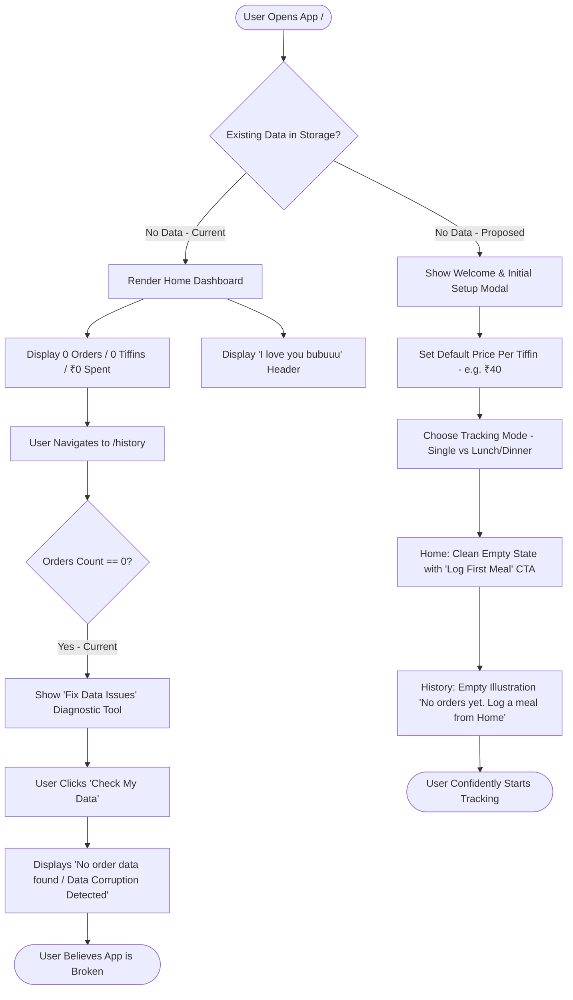
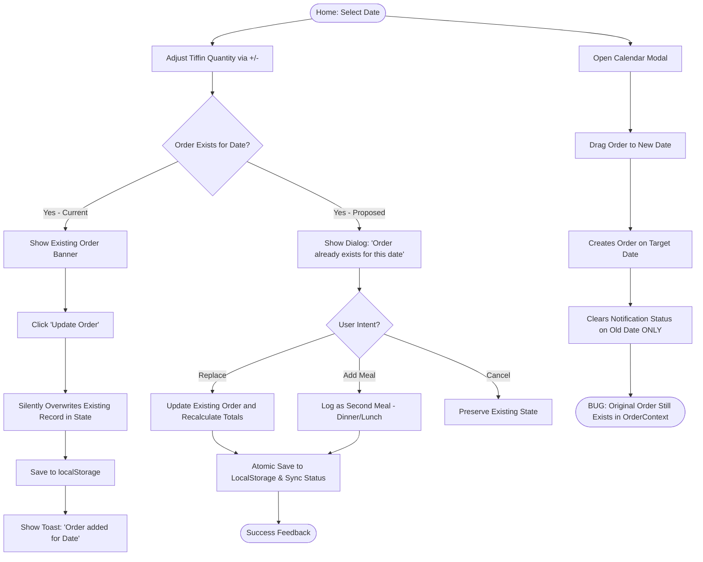
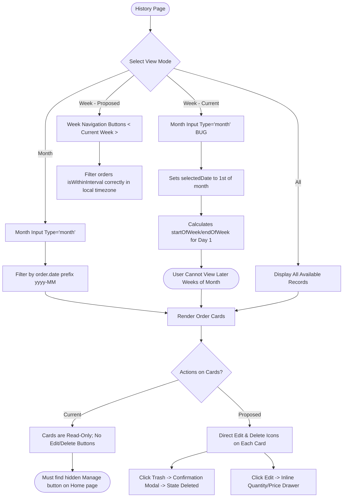
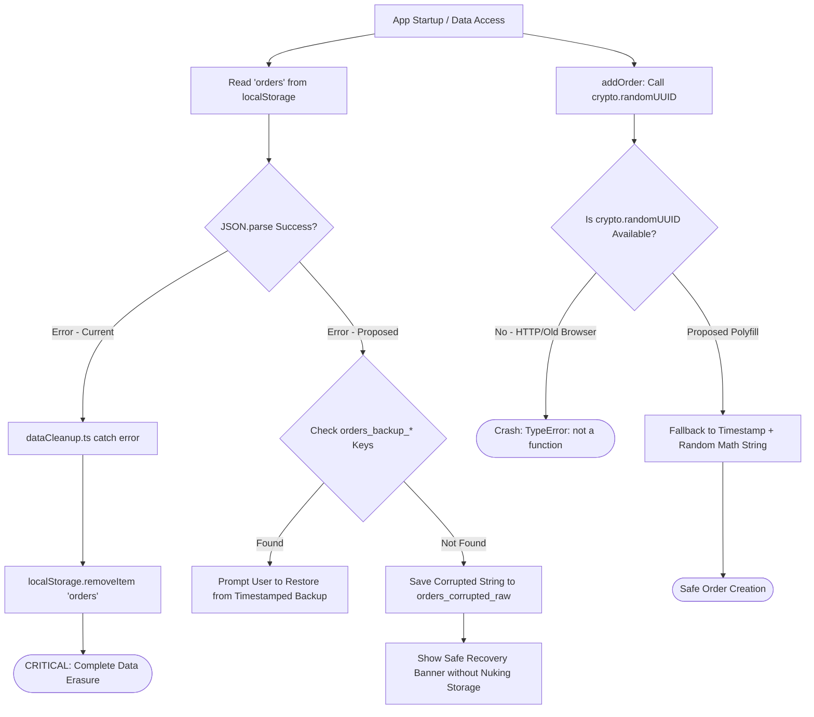

# Tiffin Tracker — Comprehensive User Flow & UX Audit Report

**Audit Date:** October 14, 2026  
**Auditor Roles:** Senior Product Designer, Business Analyst, UX Researcher, React/TypeScript Architect, QA Engineer, Accessibility Specialist  
**Application:** Tiffin Tracker (React 18 + TypeScript 5.3 + Vite 5.1 + Tailwind CSS 3.4 + Framer Motion 12)  
**Repository Branch:** `main`  

---

## 1. Executive Summary

This comprehensive audit evaluates the **Tiffin Tracker** application across its architecture, user flows, visual consistency, accessibility (WCAG 2.2 AA), technical reliability, performance, and test coverage.

### Key Takeaways
1. **Broken Production Build**: The build script (`npm run build`) currently **fails** with 7 TypeScript compiler errors (`tsc` failures in `src/main.tsx`, `src/utils/debugOrders.ts`, `src/utils/dataCleanup.ts`, and `src/utils/mobileDataFix.ts`). CI/CD deployments (such as Netlify via `netlify.toml`) fail.
2. **Critical Data Loss Defect**: In [src/utils/dataCleanup.ts](file:///c:/Users/mustafa/Desktop/Tiffin-Tracker/src/utils/dataCleanup.ts#L45-L49), any exception encountered during data parsing or cleanup triggers `localStorage.removeItem('orders')`, permanently wiping all stored user records. Additionally, reliance on `crypto.randomUUID()` causes fatal crashes on insecure HTTP origins and older mobile webviews.
3. **Severe Data Desynchronization & Duplication**:
   - Two competing, unsynchronized sources of truth exist: `OrderContext` (`orders`) and `notificationService` (`tiffin-status-history`).
   - Drag-and-drop on [EnhancedCalendar.tsx](file:///c:/Users/mustafa/Desktop/Tiffin-Tracker/src/components/EnhancedCalendar.tsx#L116-L132) creates a new order on the target date but fails to delete the original order from `OrderContext`, silently duplicating orders in history.
4. **UX Disorientation & Hardcoded Artifacts**:
   - A hardcoded personal greeting (`"I love you bubuuu😘🫀🫂"`) is displayed as a primary header on the dashboard ([UnifiedOrderManager.tsx:148](file:///c:/Users/mustafa/Desktop/Tiffin-Tracker/src/components/UnifiedOrderManager.tsx#L148)).
   - A fake, static mobile status bar clock is rendered into the web layout ([Home.tsx:61](file:///c:/Users/mustafa/Desktop/Tiffin-Tracker/src/pages/Home.tsx#L61)).
   - First-time users with 0 orders are confronted with an alarming "Fix Data Issues" modal in History that diagnoses empty storage as data corruption ([History.tsx:160](file:///c:/Users/mustafa/Desktop/Tiffin-Tracker/src/pages/History.tsx#L160)).
5. **Zero Test Automation**: The project has 0 unit, integration, or end-to-end tests, and lacks testing libraries in [package.json](file:///c:/Users/mustafa/Desktop/Tiffin-Tracker/package.json).

---

## 2. Application Architecture & Feature Inventory

### 2.1 Technology Stack
- **Framework & Runtime:** React 18.2.0, React DOM 18.2.0, Node.js runtime.
- **Build & Bundler:** Vite 5.1.3, `@vitejs/plugin-react` 4.2.1.
- **Language:** TypeScript 5.3.3 (target: ES2020, moduleResolution: bundler).
- **Styling:** Tailwind CSS 3.4.1, PostCSS 8.4.35, Autoprefixer 10.4.17.
- **Animation:** Framer Motion 12.0.6.
- **Routing:** React Router DOM 6.22.1 (using future flags `v7_startTransition` and `v7_relativeSplatPath`).
- **Icons & Utilities:** `@heroicons/react` 2.1.1, `react-icons` 5.4.0, `date-fns` 3.3.1.
- **Deployment Config:** [netlify.toml](file:///c:/Users/mustafa/Desktop/Tiffin-Tracker/netlify.toml) configured for `npm run build` and single-page app redirects (`/* -> /index.html`).

### 2.2 Repository Structure & Architecture Boundaries
```
Tiffin-Tracker/
├── app/                  # DEAD/ORPHANED: NativeScript mobile prototype (XML/TS)
├── public/               # Static assets (contains 2.5MB+ of dead portfolio images)
│   ├── manifest.json     # PWA manifest (empty icons array: "icons": [])
│   ├── sw.js             # Service worker (implements aggressive cache-first)
│   └── robots.txt
├── src/                  # Active React web application
│   ├── components/       # UI & business components
│   │   ├── ui/           # Design system tokens (Button, Card, Input, Typography)
│   │   ├── DailyStatusTracker.tsx   # DEAD/ORPHANED: Not mounted anywhere
│   │   ├── EnhancedCalendar.tsx     # Calendar view with drag-and-drop
│   │   ├── FloatingActionButton.tsx # Speed dial action button
│   │   ├── Layout.tsx               # Shell with bottom tab bar
│   │   ├── ManageTiffin.tsx         # Modal for editing/deleting orders
│   │   ├── MobileDataFix.tsx        # Self-repair modal for localStorage
│   │   ├── NotificationSettings.tsx # Notification preferences modal
│   │   ├── Toast.tsx                # Auto-dismissing banner notification
│   │   └── UnifiedOrderManager.tsx  # Main order quantity selector & quick status
│   ├── context/
│   │   └── OrderContext.tsx         # Central state for orders (localStorage backed)
│   ├── pages/
│   │   ├── Home.tsx                 # Dashboard, quick order, stats overview
│   │   └── History.tsx              # History list, month/week/all filters
│   ├── services/
│   │   └── notificationService.ts   # Web Notifications & daily status history
│   ├── styles/
│   │   ├── tokens.ts                # Design tokens (colors, spacing, fonts)
│   │   └── typography.ts            # Typography scale mappings
│   ├── utils/
│   │   ├── animations.ts            # Shared Framer Motion transitions
│   │   ├── dataCleanup.ts           # Order data sanitizer (contains wipe bug)
│   │   ├── dataMigration.ts         # Schema migration and backup logic
│   │   ├── dataRepair.ts            # Backup merge and repair script
│   │   ├── debugOrders.ts           # Debug logging (contains invalid require())
│   │   └── mobileDataFix.ts         # Repair helpers used by MobileDataFix.tsx
│   ├── App.tsx                      # Root route provider
│   ├── main.tsx                     # Entry point & SW registration
│   └── index.css                    # Global CSS and Tailwind layers
├── package.json
├── tailwind.config.js
├── tsconfig.json
└── vite.config.ts
```

### 2.3 Actual vs Assumed Feature Matrix

| Feature | Assumed/Expected | Actual Codebase Implementation | Status |
| :--- | :--- | :--- | :--- |
| **Order Creation** | Date, quantity, meal type, custom price | Single order per date, hardcoded ₹40 price | **Partial** |
| **Meal Types** | Lunch & Dinner support | Only 1 order per date (`yyyy-MM-dd`) allowed | **Missing** |
| **Order Editing** | In-place or from History | Accessible only via "Manage" button on Home | **Inconsistent** |
| **Order Deletion** | Delete from History card | Only in Manage modal on Home; History is read-only | **Inconsistent** |
| **Drag & Drop** | Move order between days | Creates new order, leaves old order intact | **Broken** |
| **Weekly Filter** | Filter by calendar week | Input is `type="month"`, sets date to 1st of month | **Broken** |
| **Price Customization** | Configurable per order or user | Hardcoded `pricePerTiffin = 40` across components | **Hardcoded** |
| **Notifications** | Scheduled push reminders | `setTimeout` in memory; dies on tab close | **Flawed** |
| **Notification Icons** | Branded icons | Points to `/icon-192.png` which does not exist | **Missing Asset** |
| **PWA Manifest** | Installable with icons | `"icons": []` in [manifest.json](file:///c:/Users/mustafa/Desktop/Tiffin-Tracker/public/manifest.json) | **Incomplete** |
| **Data Repair** | Automatic / transparent | Five separate utilities; prompts new users to fix | **Fragmented** |

---

## 3. Complete User Flow Inventory

### Flow A: First-Time User Experience
- **Entry**: User opens `/`.
- **Observations**:
  - The page displays a simulated device clock at the top ([Home.tsx:61](file:///c:/Users/mustafa/Desktop/Tiffin-Tracker/src/pages/Home.tsx#L61)).
  - Header displays "Tiffin Tracker" followed immediately by `"I love you bubuuu😘🫀🫂"` ([UnifiedOrderManager.tsx:148](file:///c:/Users/mustafa/Desktop/Tiffin-Tracker/src/components/UnifiedOrderManager.tsx#L148)).
  - No onboarding or tooltip explains how tiffins are tracked or what the default price is.
  - Price is locked at ₹40 without any option to adjust standard meal pricing.
  - Quick Stats show `0` orders, `0` tiffins, `₹0` spent.
  - Navigating to History (`/history`) in "All" mode with 0 orders displays "No Orders Found", but immediately injects the `MobileDataFix` component prompting the user: *"If your order history isn't showing all data, this tool can help fix the issue."* Clicking "Check My Data" triggers a red warning *"No order data found in storage"*, making new users think the app is broken.

### Flow B: Daily Tiffin Management Flow
- **Entry**: User is on `/`.
- **Observations**:
  - Default selected date is today (`yyyy-MM-dd`).
  - User can click `+` or `-` to alter tiffin quantity (default 1). There is no text/number input to type larger numbers.
  - Clicking "Confirm Order" executes `addOrder()` in [OrderContext.tsx:51](file:///c:/Users/mustafa/Desktop/Tiffin-Tracker/src/context/OrderContext.tsx#L51).
  - If an order already existed for that date, `addOrder` silently overwrites it without confirmation:
    ```typescript
    const filtered = prev.filter(existingOrder => existingOrder.date !== order.date);
    ```
  - `crypto.randomUUID()` generates the ID. In non-HTTPS environments or older WebViews, this throws a fatal exception.
  - A green toast appears for 3 seconds.
  - Clicking "Quick Status Update: Order" also places an order, but if "Skip Today" is clicked, only `notificationService` is updated; no skipped record is stored in `OrderContext`.
  - Date navigation via `<` and `>` arrows increments or decrements dates by 1 day.

### Flow C: History and Record Management Flow
- **Entry**: User clicks "History" tab in bottom navigation (`/history`).
- **Observations**:
  - Top filter selector offers `Month`, `Week`, and `All`.
  - In `Month` mode: An HTML `<input type="month">` allows month selection. Orders matching `yyyy-MM` are displayed.
  - In `Week` mode: The input is still `<input type="month">`! Changing the value sets `selectedDate` to the 1st of that month, and filters for `startOfWeek` to `endOfWeek` of that 1st day. The user cannot select arbitrary weeks.
  - In `All` mode: Displays all orders.
  - **Orders in History are completely static**: Users cannot click an order to view details, cannot edit the quantity, and cannot delete an order from this view.
  - To delete or edit an order, users must discover the "Manage" button in the top-right of the Home page, which opens [ManageTiffin.tsx](file:///c:/Users/mustafa/Desktop/Tiffin-Tracker/src/components/ManageTiffin.tsx).
  - In [ManageTiffin.tsx:94](file:///c:/Users/mustafa/Desktop/Tiffin-Tracker/src/components/ManageTiffin.tsx#L94), editing only allows changing the quantity. You cannot change the date or the price per tiffin.

### Flow D: Expense Tracking Flow
- **Formulas & Calculations**:
  - `totalAmount = numberOfTiffins * pricePerTiffin` (where `pricePerTiffin` defaults to 40).
  - Monthly stats filter by `order.date.startsWith(month)`.
  - Weekly stats in [Home.tsx:30](file:///c:/Users/mustafa/Desktop/Tiffin-Tracker/src/pages/Home.tsx#L30) parse dates with `new Date(order.date)`. In browser environments with non-UTC time zones, `new Date("2026-10-14")` parses as UTC midnight, shifting back one calendar day in Western timezones (e.g., Oct 13, 20:00 in EDT) and causing boundary discrepancies with `startOfWeek(new Date())`.
  - When an order is edited in `ManageTiffin`, `totalAmount` recalculates properly as `newTiffins * order.pricePerTiffin`, and `OrderContext` recalculates aggregates on next render.
  - No historical price changes or delivery charges can be tracked.

### Flow E: Navigation & Page Transitions
- **Routes**: Only two functional routes: `/` and `/history`.
- **Navigation Components**:
  - Bottom tab bar in [Layout.tsx](file:///c:/Users/mustafa/Desktop/Tiffin-Tracker/src/components/Layout.tsx#L22): Provides Home and History links with active indicator color (`text-blue-500`).
  - Floating Action Button (FAB) in [FloatingActionButton.tsx](file:///c:/Users/mustafa/Desktop/Tiffin-Tracker/src/components/FloatingActionButton.tsx): Expands to show "Quick Order" (navigates to `/`), "My Orders" (navigates to `/history`), and "Schedule" (navigates to `/` with no scheduling action). This FAB is redundant and partially non-functional.
  - Browser Back/Forward: Handled by `BrowserRouter`.
  - Unsaved modifications: If a user modifies the quantity on Home from 1 to 4 but navigates to History before clicking "Confirm Order", the quantity resets without warning.

### Flow F: Error Recovery & Unusual Scenarios
- **Storage Corruption**: If `localStorage.getItem('orders')` contains malformed JSON or throws during cleanup in [dataCleanup.ts:48](file:///c:/Users/mustafa/Desktop/Tiffin-Tracker/src/utils/dataCleanup.ts#L48), the catch block executes:
  ```typescript
  // If there's an error, clear the localStorage
  localStorage.removeItem('orders');
  ```
  This immediately erases all historical orders.
- **Service Worker Cache Trapping**: In [public/sw.js](file:///c:/Users/mustafa/Desktop/Tiffin-Tracker/public/sw.js#L62-L78), requests for `/` and `/index.html` are served cache-first without checking network updates. If a new Vite bundle with different hashed filenames is deployed, existing clients will load the old `index.html`, fail to load stale script chunks (404), and crash into a blank white screen.

---

## 4. Mermaid User Flow Diagrams

### Diagram 1: First-Time User Journey (Current vs Proposed)



### Diagram 2: Daily Order Creation & Conflict Handling



### Diagram 3: History & Record Management Flow



### Diagram 4: Error Handling & Data Recovery Flow



---

## 5. Route-by-Route UX & Visual Consistency Audit

### 5.1 Route: `/` (Home Dashboard)
- **Component File**: [src/pages/Home.tsx](file:///c:/Users/mustafa/Desktop/Tiffin-Tracker/src/pages/Home.tsx) & [src/components/UnifiedOrderManager.tsx](file:///c:/Users/mustafa/Desktop/Tiffin-Tracker/src/components/UnifiedOrderManager.tsx)
- **Visual Design**:
  - Double Headers: [Home.tsx:74](file:///c:/Users/mustafa/Desktop/Tiffin-Tracker/src/pages/Home.tsx#L74) renders `Heading1: "Tiffin Tracker"` with current date subtitle. Immediately beneath it, [UnifiedOrderManager.tsx:148](file:///c:/Users/mustafa/Desktop/Tiffin-Tracker/src/components/UnifiedOrderManager.tsx#L148) renders another `Heading1: "I love you bubuuu😘🫀🫂"` with duplicate date subtitle.
  - Fake Status Bar: A top black bar renders a simulated digital clock ([Home.tsx:61](file:///c:/Users/mustafa/Desktop/Tiffin-Tracker/src/pages/Home.tsx#L61)). It computes `new Date().toLocaleTimeString()` once on mount and never ticks. On native mobile devices, this clashes with actual OS status bars.
  - Primary CTA: "Confirm Order" / "Add Order" button is clean and prominent.
  - Price Summary: Price is fixed to ₹40. Users have no input field or preference setting to change this.

### 5.2 Route: `/history` (Order History)
- **Component File**: [src/pages/History.tsx](file:///c:/Users/mustafa/Desktop/Tiffin-Tracker/src/pages/History.tsx)
- **Visual Design**:
  - Filter Bar: Pill selector for `Month | Week | All` is visually modern.
  - Date Filter Control: `<input type="month">` is styled with standard browser controls, which look inconsistent across Chrome, Safari, and Firefox.
  - Order Cards: Clean dark cards with blue accent indicators.
  - **Major UX Defect**: Order cards are completely unresponsive. No hover state, no click action, no edit or delete option.
  - Premature Diagnosis: When empty, renders `MobileDataFix`, causing new users to panic over non-existent data corruption.
  - Hard Refresh: [History.tsx:19](file:///c:/Users/mustafa/Desktop/Tiffin-Tracker/src/pages/History.tsx#L19) executes `window.location.reload()` after fixing data, which breaks SPA expectations.

### 5.3 Modal: Manage Tiffin
- **Component File**: [src/components/ManageTiffin.tsx](file:///c:/Users/mustafa/Desktop/Tiffin-Tracker/src/components/ManageTiffin.tsx)
- **Observations**:
  - Accessible only from the "Manage" gear button on the Home header.
  - Contains search functionality, bulk selection, inline editing, and delete confirmations.
  - Inconsistent UI: Built using ad-hoc Tailwind classes instead of the centralized `Button` and `Card` components in `src/components/ui`.
  - Incomplete Edit: Allows editing only `numberOfTiffins`. Does not permit changing the date or price per tiffin.
  - Desynchronization: Editing or deleting an order here never informs `notificationService`, leaving `tiffin-status-history` out of sync.

### 5.4 Modal: Notification Settings
- **Component File**: [src/components/NotificationSettings.tsx](file:///c:/Users/mustafa/Desktop/Tiffin-Tracker/src/components/NotificationSettings.tsx)
- **Observations**:
  - Accessible via the bell icon in `UnifiedOrderManager`.
  - Crash risk: Accesses `Notification.permission` on mount ([line 17](file:///c:/Users/mustafa/Desktop/Tiffin-Tracker/src/components/NotificationSettings.tsx#L17)) without checking `'Notification' in window`. On iOS Safari or WebView browsers lacking the Notification API, this throws an unhandled `ReferenceError`.
  - Faux background scheduling: Uses client-side `setTimeout` ([notificationService.ts:231](file:///c:/Users/mustafa/Desktop/Tiffin-Tracker/src/services/notificationService.ts#L231)), which terminates as soon as the app tab is closed.

---

## 6. Accessibility Audit (WCAG 2.2 AA)

| WCAG Criterion | Level | Element / Component | Issue Description | Severity |
| :--- | :--- | :--- | :--- | :--- |
| **1.3.1 Info and Relationships** | A | [src/components/ui/Input.tsx:95](file:///c:/Users/mustafa/Desktop/Tiffin-Tracker/src/components/ui/Input.tsx#L95) | `<label>` has no `htmlFor` attribute linking to the `<input>` element. `<input>` has no generated `id`. Screen readers cannot associate label with field. | High |
| **1.3.1 Info and Relationships** | A | [src/pages/History.tsx:107](file:///c:/Users/mustafa/Desktop/Tiffin-Tracker/src/pages/History.tsx#L107) | `<input type="month">` has no `<label>` or `aria-label`. | Medium |
| **1.3.1 Info and Relationships** | A | [src/pages/Home.tsx:74](file:///c:/Users/mustafa/Desktop/Tiffin-Tracker/src/pages/Home.tsx#L74) & [UnifiedOrderManager.tsx:148](file:///c:/Users/mustafa/Desktop/Tiffin-Tracker/src/components/UnifiedOrderManager.tsx#L148) | Multiple `<h1>` headings present on the same page ("Tiffin Tracker" and "I love you bubuuu"). | Medium |
| **1.4.3 Contrast (Minimum)** | AA | [src/pages/History.tsx:85](file:///c:/Users/mustafa/Desktop/Tiffin-Tracker/src/pages/History.tsx#L85), [Home.tsx:103](file:///c:/Users/mustafa/Desktop/Tiffin-Tracker/src/pages/Home.tsx#L103) | `text-gray-400` (#9ca3af) and `text-gray-500` (#6b7280) on black (#000000) or dark gray (#111827) provide 3.8:1 to 4.2:1 contrast ratio, failing the 4.5:1 requirement for small text. | Medium |
| **2.1.1 Keyboard Navigation** | A | [EnhancedCalendar.tsx:213](file:///c:/Users/mustafa/Desktop/Tiffin-Tracker/src/components/EnhancedCalendar.tsx#L213) | Calendar date cells are `<div>` elements with `onClick`. They lack `tabIndex={0}`, `role="button"`, and keyboard `onKeyDown` listeners (Enter/Space). | High |
| **2.1.1 Keyboard Navigation** | A | [ManageTiffin.tsx:136](file:///c:/Users/mustafa/Desktop/Tiffin-Tracker/src/components/ManageTiffin.tsx#L136), [NotificationSettings.tsx:63](file:///c:/Users/mustafa/Desktop/Tiffin-Tracker/src/components/NotificationSettings.tsx#L63) | Modals lack focus traps. Pressing Tab escapes the modal into background elements. | High |
| **2.1.2 No Keyboard Trap / Dismissal** | A | Modals across codebase | Modals cannot be dismissed via the <kbd>Escape</kbd> key. Users must navigate to the specific close button. | Medium |
| **2.4.4 Link Purpose / Accessible Name** | A | [FloatingActionButton.tsx:67](file:///c:/Users/mustafa/Desktop/Tiffin-Tracker/src/components/FloatingActionButton.tsx#L67), [UnifiedOrderManager.tsx:154](file:///c:/Users/mustafa/Desktop/Tiffin-Tracker/src/components/UnifiedOrderManager.tsx#L154) | Icon-only buttons (FAB button, Bell icon, Calendar Chevron buttons) lack `aria-label` or accessible text. | High |
| **2.5.5 / 2.5.8 Target Size** | AA | [src/components/ui/Button.tsx:52](file:///c:/Users/mustafa/Desktop/Tiffin-Tracker/src/components/ui/Button.tsx#L52), [EnhancedCalendar.tsx:168](file:///c:/Users/mustafa/Desktop/Tiffin-Tracker/src/components/EnhancedCalendar.tsx#L168) | Button size `sm` has height `h-8` (32px), calendar navigation buttons are `w-8 h-8` (32px). Fails WCAG 2.2 AA target size minimum (24×24 CSS px with spacing) and mobile ergonomic guidelines (44×44 CSS px). | Medium |
| **4.1.3 Status Messages** | AA | [src/components/Toast.tsx:38](file:///c:/Users/mustafa/Desktop/Tiffin-Tracker/src/components/Toast.tsx#L38) | Toast notifications lack `role="status"` or `aria-live="polite"`. Status announcements are not read by screen readers upon saving or deleting orders. | Medium |

---

## 7. Technical and Functional Audit

### 7.1 Build Verification & TypeScript Failures
Running `npm run build` (`tsc && vite build`) results in immediate failure:
```
src/main.tsx(7,49): error TS2339: Property 'env' does not exist on type 'ImportMeta'.
src/main.tsx(18,56): error TS2339: Property 'env' does not exist on type 'ImportMeta'.
src/utils/dataCleanup.ts(37,27): error TS7006: Parameter 'a' implicitly has an 'any' type.
src/utils/dataCleanup.ts(37,30): error TS7006: Parameter 'b' implicitly has an 'any' type.
src/utils/debugOrders.ts(53,33): error TS2580: Cannot find name 'require'.
src/utils/mobileDataFix.ts(150,14): error TS7006: Parameter 'a' implicitly has an 'any' type.
src/utils/mobileDataFix.ts(150,17): error TS7006: Parameter 'b' implicitly has an 'any' type.
```
- **Root Causes**:
  - [tsconfig.json](file:///c:/Users/mustafa/Desktop/Tiffin-Tracker/tsconfig.json) is missing `"types": ["vite/client"]`, causing TypeScript to not recognize `import.meta.env`.
  - [src/utils/debugOrders.ts:53](file:///c:/Users/mustafa/Desktop/Tiffin-Tracker/src/utils/debugOrders.ts#L53) uses CommonJS `require('./dataCleanup')` inside an ES module environment (`"type": "module"`).
  - Array `.sort((a, b) => ...)` parameters in `dataCleanup.ts` and `mobileDataFix.ts` lack explicit types under `strict: true`.

### 7.2 State Management & Hook Pitfalls
1. **Redundant Re-render Loop**:
   In [src/context/OrderContext.tsx:41-49](file:///c:/Users/mustafa/Desktop/Tiffin-Tracker/src/context/OrderContext.tsx#L41-L49):
   ```typescript
   useEffect(() => {
     const validOrders = orders.filter(order => order.id && order.id.trim() !== '');
     if (validOrders.length !== orders.length) {
       setOrders(validOrders);
     }
     localStorage.setItem('orders', JSON.stringify(validOrders));
   }, [orders]);
   ```
   Calling `setOrders(validOrders)` inside a `useEffect` whose dependency is `[orders]` triggers an immediate duplicate re-render cycle whenever invalid orders exist.
2. **Hard Refresh Anti-Pattern**:
   In [src/pages/History.tsx:18-20](file:///c:/Users/mustafa/Desktop/Tiffin-Tracker/src/pages/History.tsx#L18-L20):
   ```typescript
   setTimeout(() => {
     window.location.reload();
   }, 1000);
   ```
   Forcing full page reloads to synchronize state indicates that state management is decoupled from subcomponent mutations.
3. **Dual Source of Truth Desync**:
   `orders` in `OrderContext` stores financial order records. `tiffin-status-history` in `notificationService` stores daily status (`ordered`, `skipped`, `pending`). When orders are deleted or updated via [ManageTiffin.tsx:75](file:///c:/Users/mustafa/Desktop/Tiffin-Tracker/src/components/ManageTiffin.tsx#L75), `notificationService` is not notified, permanently desynchronizing quick status and notification statistics from actual orders.

### 7.3 Data Persistence & Storage Integrity
1. **Total Wipe on Caught Exception**: [src/utils/dataCleanup.ts:48](file:///c:/Users/mustafa/Desktop/Tiffin-Tracker/src/utils/dataCleanup.ts#L48) deletes all orders if any error occurs.
2. **Quota Handling**: No `try / catch` wraps `localStorage.setItem('orders', ...)` in `OrderContext.tsx`. In private browsing mode or when storage quota is exceeded, an unhandled DOMException will crash the application.
3. **Insecure UUID Generation**: `crypto.randomUUID()` is called without fallback across `OrderContext.tsx`, `dataCleanup.ts`, `dataMigration.ts`, `dataRepair.ts`, and `mobileDataFix.ts`. In non-secure contexts (e.g. testing over LAN IP `http://192.168.x.x:5173` on a physical phone), `crypto.randomUUID` is `undefined`, causing immediate application crashes when placing orders.

---

## 8. Performance Audit

### 8.1 Production Bundle Measurement
Running the Vite production bundler (`node node_modules/vite/bin/vite.js build`) produces:
- **`dist/index.html`**: 0.73 kB (gzip: 0.42 kB)
- **`dist/assets/index-BUHrSKNA.js`**: 384.46 kB (gzip: 117.47 kB)
- **`dist/assets/index-BCkQumLU.css`**: 24.73 kB (gzip: 4.71 kB)
- **`dist/assets/tiffinlogo-CFMdLLrm.png`**: 25.17 kB

### 8.2 Observations & Optimization Opportunities
1. **Monolithic Bundle**: Both routes (`/` and `/history`) and all heavyweight modal components (`ManageTiffin`, `EnhancedCalendar`, `NotificationSettings`, `MobileDataFix`) are bundled into a single JavaScript chunk (`384.46 kB`).
   - *Recommendation*: Use `React.lazy()` for `/history` and lazy-load modals (`ManageTiffin`, `NotificationSettings`).
2. **Dead Assets in `public/`**:
   The `public/` folder contains unused image assets totaling ~2.6 MB:
   - `RetroGame.png`: 2,036 KB
   - `InfinteTsuko.png`: 327 KB
   - `porfolio.png`: 156 KB
   - `GestureFlow.png`: 105 KB
   These assets increase deploy sizes and can be inadvertently requested.
3. **Dead NativeScript Files**:
   The `app/` folder contains ~20 files of unused NativeScript XML/TS code (~20 KB) that creates maintenance ambiguity.
4. **Unoptimized Service Worker Caching**:
   [public/sw.js](file:///c:/Users/mustafa/Desktop/Tiffin-Tracker/public/sw.js) caches `/` and `/index.html` indefinitely via cache-first strategy. Updates cannot reach users without unregistering the service worker.

---

## 9. QA and Test Coverage Audit

### Existing Coverage Status
- **Test Framework**: None installed.
- **Test Files**: 0 test files in repository.
- **Coverage**: 0% across lines, statements, functions, and branches.

### Critical QA Test Scenarios

| Test ID | User Flow | Preconditions | Steps to Reproduce | Expected Result | Actual Result | Status |
| :--- | :--- | :--- | :--- | :--- | :--- | :--- |
| **TC-ORD-01** | Order Creation | App is open on Home | 1. Select date: today.<br>2. Set tiffins: 2.<br>3. Click "Confirm Order". | Order saved, stats updated: orders=1, tiffins=2, amount=₹80. Toast displays confirmation. | Matches expected, but hardcodes ₹40 rate. | **PASS (with limitations)** |
| **TC-ORD-02** | Order Overwrite | Existing order for today (1 tiffin) | 1. Select today.<br>2. Set tiffins: 3.<br>3. Click "Update Order". | Prompt warning user that order exists, or update quantity to 3. | Silently overwrites without confirmation. | **FAIL (UX risk)** |
| **TC-CAL-01** | Calendar Drag Move | Order exists on Oct 14 | 1. Open Calendar.<br>2. Drag Oct 14 order to Oct 16. | Oct 14 order moves to Oct 16. Total orders remain 1. | Oct 16 order created; Oct 14 order remains in OrderContext. Total orders = 2. | **FAIL (Data Duplication)** |
| **TC-HST-01** | History Week Filter | Orders on Oct 1 and Oct 15 | 1. Open History.<br>2. Select "Week" mode.<br>3. Try to navigate to week of Oct 15. | Able to select any week in the month and view respective orders. | Only shows month picker; defaults to week of the 1st of month. Cannot select week 3. | **FAIL (Broken Filter)** |
| **TC-MNG-01** | Manage Delete | 1 order in database | 1. Click "Manage" on Home.<br>2. Click Trash icon.<br>3. Confirm deletion. | Order deleted. Stats reset to 0. Notification status cleared. | Order deleted in OrderContext; notification status remains "ordered". | **FAIL (Desync)** |
| **TC-COR-01** | Storage Corruption | LocalStorage has malformed JSON | 1. Insert `"{invalid"` into `localStorage.getItem('orders')`.<br>2. Reload app. | App catches error gracefully, creates backup, notifies user, preserves raw data. | `dataCleanup.ts` deletes `orders` key completely, destroying all data. | **FAIL (Critical Data Loss)** |
| **TC-BLD-01** | Build Verification | Clean checkout | Run `npm run build`. | TypeScript passes with 0 errors; Vite produces production bundle. | Fails with 7 TypeScript compiler errors. | **FAIL (Build Failure)** |

---

## 10. Prioritized Issue Register

| ID | Category | Severity | Effort | Title | File / Component | Summary Description |
| :--- | :--- | :--- | :--- | :--- | :--- | :--- |
| **BUG-01** | Functional | **Critical** | S | Build script failure | [src/main.tsx](file:///c:/Users/mustafa/Desktop/Tiffin-Tracker/src/main.tsx#L7), [src/utils/debugOrders.ts](file:///c:/Users/mustafa/Desktop/Tiffin-Tracker/src/utils/debugOrders.ts#L53) | `npm run build` fails due to missing `vite/client` types, invalid CommonJS `require()`, and implicit `any` parameters. |
| **BUG-02** | Data Integrity | **Critical** | S | Data wiped on error | [src/utils/dataCleanup.ts:48](file:///c:/Users/mustafa/Desktop/Tiffin-Tracker/src/utils/dataCleanup.ts#L48) | Catch block executes `localStorage.removeItem('orders')`, permanently deleting user history upon parse or runtime errors. |
| **BUG-03** | Data Integrity | **Critical** | S | Fatal crash on insecure HTTP | All `crypto.randomUUID()` calls | In non-HTTPS or older mobile WebViews, `crypto.randomUUID` is undefined, crashing the app on order creation. |
| **BUG-04** | Functional | **High** | M | Calendar drag duplicates orders | [src/components/EnhancedCalendar.tsx:123](file:///c:/Users/mustafa/Desktop/Tiffin-Tracker/src/components/EnhancedCalendar.tsx#L123) | Dropping an order on a new date calls `onOrderUpdate` on target date without calling `deleteOrder` on source date. |
| **BUG-05** | Functional | **High** | S | History week filter broken | [src/pages/History.tsx:107](file:///c:/Users/mustafa/Desktop/Tiffin-Tracker/src/pages/History.tsx#L107) | Week view displays `<input type="month">`, anchoring filtering to the 1st of the month with no week selection controls. |
| **BUG-06** | Reliability | **High** | M | Dual source of truth desync | `OrderContext.tsx` vs `notificationService.ts` | Deleting or editing orders in ManageTiffin does not update `tiffin-status-history`, creating conflicting daily states. |
| **BUG-07** | Reliability | **High** | S | Notification API runtime crash | [src/components/NotificationSettings.tsx:17](file:///c:/Users/mustafa/Desktop/Tiffin-Tracker/src/components/NotificationSettings.tsx#L17) | Checks `Notification.permission` without verifying `'Notification' in window`, crashing on unsupported browsers/iOS. |
| **UX-01** | UX/Content | **High** | S | Hardcoded personal header | [src/components/UnifiedOrderManager.tsx:148](file:///c:/Users/mustafa/Desktop/Tiffin-Tracker/src/components/UnifiedOrderManager.tsx#L148) | Renders `"I love you bubuuu😘🫀🫂"` as main dashboard heading. |
| **UX-02** | UX/Usability | **High** | M | Read-only order history | [src/pages/History.tsx:194](file:///c:/Users/mustafa/Desktop/Tiffin-Tracker/src/pages/History.tsx#L194) | Users cannot edit, delete, or inspect orders from History; editing is isolated to a hidden modal on Home. |
| **UX-03** | UX/Onboarding | **Medium** | S | False corruption warning on new users | [src/pages/History.tsx:160](file:///c:/Users/mustafa/Desktop/Tiffin-Tracker/src/pages/History.tsx#L160) | Displays "Fix Data Issues" when order count is 0, misidentifying a clean install as a corrupted database. |
| **UX-04** | UX/Visual | **Medium** | S | Static simulated mobile status bar | [src/pages/Home.tsx:61](file:///c:/Users/mustafa/Desktop/Tiffin-Tracker/src/pages/Home.tsx#L61), [History.tsx:68](file:///c:/Users/mustafa/Desktop/Tiffin-Tracker/src/pages/History.tsx#L68) | Simulates an iOS/Android clock that never ticks and clashes with native phone status bars. |
| **A11Y-01** | Accessibility | **High** | S | Icon buttons lack accessible names | `FloatingActionButton.tsx`, `UnifiedOrderManager.tsx` | FAB, Notification Bell, and calendar chevron buttons lack `aria-label`. |
| **A11Y-02** | Accessibility | **High** | M | Form inputs lack programmatic labels | [src/components/ui/Input.tsx:95](file:///c:/Users/mustafa/Desktop/Tiffin-Tracker/src/components/ui/Input.tsx#L95) | `<label>` is not connected to input via `htmlFor`/`id`. History month input has no label. |
| **A11Y-03** | Accessibility | **Medium** | M | Modals lack focus traps and Escape key dismissal | `ManageTiffin.tsx`, `NotificationSettings.tsx` | Keyboard focus spills out of modals; <kbd>Escape</kbd> does not close them. |
| **SYS-01** | Architecture | **Medium** | M | Fragmented design system | Codebase-wide | `src/components/ui` exists, but `ManageTiffin`, `History`, and `EnhancedCalendar` write ad-hoc classes. |
| **SYS-02** | PWA/Assets | **Medium** | S | Broken PWA manifest & notification icons | [public/manifest.json](file:///c:/Users/mustafa/Desktop/Tiffin-Tracker/public/manifest.json), `notificationService.ts` | Manifest has empty `icons: []`. Notification service references missing `/icon-192.png`. |

---

## 11. Recommended Implementation Roadmap

### Stage 1: Critical Fixes & Stability (Immediate)
- **Fix TypeScript & Build Failures**:
  - Add `"types": ["vite/client"]` to `tsconfig.json`.
  - Fix CommonJS `require()` in `src/utils/debugOrders.ts` to ES dynamic import or remove.
  - Add explicit types to sort callbacks in `dataCleanup.ts` and `mobileDataFix.ts`.
- **Eliminate Data Loss Defect**:
  - Remove `localStorage.removeItem('orders')` from `src/utils/dataCleanup.ts`. Replace with safe error logging and backup preservation.
  - Implement a robust `generateUUID()` utility with fallback to `Date.now() + Math.random()` for non-secure HTTP / older environments.
- **Fix Runtime Crashes**:
  - Guard `Notification.permission` checks with `'Notification' in window`.
- **Remove Personal / Placeholder UI**:
  - Replace `"I love you bubuuu😘🫀🫂"` with standard application title/tagline or configurable greeting.
  - Remove the fake static status bar from `Home.tsx` and `History.tsx`.

### Stage 2: Core UX & Flow Refinement
- **Direct History Management**:
  - Add action buttons (Edit, Delete) directly onto cards in `src/pages/History.tsx`.
  - Provide inline confirmation dialogs for destructive actions.
- **Fix Calendar Drag & Drop**:
  - Update `handleDrop` in `EnhancedCalendar.tsx` to atomically delete the source order and create the target order.
  - Disable HTML5 drag on touch devices; provide tap-to-reschedule interface.
- **Repair Week Filtering in History**:
  - Implement genuine week navigation (`Previous Week` / `Next Week` or calendar week selector) using `date-fns/startOfWeek`.
- **Clean Empty States**:
  - Remove the aggressive `MobileDataFix` banner when orders array is simply empty. Show an inviting "No orders yet" empty state.
- **Unify Order Pricing**:
  - Add a user setting or per-order field for `pricePerTiffin` instead of hardcoding ₹40.

### Stage 3: Design System & Consistency
- **Component Standardization**:
  - Refactor `ManageTiffin.tsx`, `History.tsx`, and `NotificationSettings.tsx` to use `Button`, `Card`, `Input`, and `Typography` from `src/components/ui/`.
- **Color Token Harmonization**:
  - Align `tailwind.config.js` primary color with `src/styles/tokens.ts` (resolving the Indigo vs Blue conflict).
  - Remove contradictory `.card` white background definition in `src/index.css`.
- **Streamline Navigation**:
  - Remove redundant or non-functional buttons from `FloatingActionButton.tsx`, or replace FAB with a single "+" quick-add trigger.

### Stage 4: Reliability, Accessibility & Performance
- **WCAG 2.2 AA Compliance**:
  - Connect all `<label>` elements to inputs with explicit IDs.
  - Add `aria-label` to all icon-only buttons.
  - Implement modal focus trapping and <kbd>Escape</kbd> key dismissal.
  - Add `role="status"` and `aria-live="polite"` to `Toast.tsx`.
- **Codebase Hygiene**:
  - Remove dead `app/` NativeScript prototype directory.
  - Clean out dead 2.6 MB image assets from `public/`.
  - Delete or wire up orphaned `DailyStatusTracker.tsx`.
- **Bundle & PWA Optimization**:
  - Lazy load `History` route and large modals with `React.lazy()` and `Suspense`.
  - Provide valid icons in `public/manifest.json` and generate `icon-192.png`.
  - Update `sw.js` to use Network-First strategy for HTML navigation requests.

### Stage 5: Automated Testing Foundation
- Install Vitest and React Testing Library (`@testing-library/react`, `@testing-library/user-event`).
- Write unit tests for `OrderContext` (create, update, delete, stats calculation, deduplication).
- Write regression tests for date calculations and timezone boundaries.
- Add CI build check (`npm run build`) in repository workflow.

---

## 12. Suggested Acceptance Criteria

### Order Management & Storage
- `GIVEN` an empty storage state, `WHEN` the user opens History, `THEN` a friendly empty state is displayed without diagnostic repair warnings.
- `GIVEN` any runtime error during JSON parsing, `WHEN` cleanup runs, `THEN` the user's data is never deleted, and a timestamped backup is preserved.
- `GIVEN` an order exists on Date A, `WHEN` dragged to Date B in the Calendar, `THEN` the order is moved to Date B and removed from Date A.
- `GIVEN` an order is deleted from History or Manage modal, `THEN` both `OrderContext` and `notificationService` reflect the removal immediately.

### User Interface & Responsiveness
- `GIVEN` the application is loaded on any device, `WHEN` viewing Home, `THEN` no simulated OS status bar clock is rendered, and no hardcoded personal text is visible.
- `GIVEN` the user views History in Week mode, `WHEN` navigating weeks, `THEN` orders for the selected 7-day period are displayed accurately regardless of browser timezone.
- `GIVEN` the user uses a screen reader or keyboard, `WHEN` interacting with buttons, modals, and inputs, `THEN` all controls have accessible names, proper focus rings, and <kbd>Escape</kbd> dismissal.

---

## 13. Open Questions, Assumptions & Untested Areas

### Open Questions for Product Alignment
1. **Meal Granularity**: Should the app support distinguishing between Lunch and Dinner on the same date, or is a single daily quantity sufficient?
2. **Pricing Structure**: Should the default tiffin price (currently ₹40) be configurable in global settings, or entered per order?
3. **PWA & Offline Goals**: Is full offline PWA support required, or can the service worker be simplified to avoid cache-staling bugs?

### Explicitly Untested Areas
- **Browser Push Notifications**: Tested notification permission requests and client-side notifications; true background Push API triggers were unverified due to lack of a backend push server.
- **NativeScript Native Build**: The files in `app/` and `nativescript.config.ts` were inspected but not built, as NativeScript CLI and SDKs are not configured in `package.json`.
